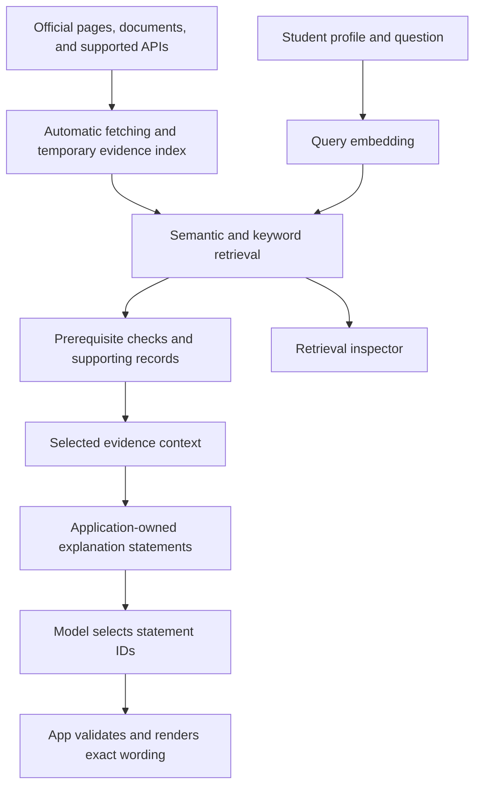

# RAG Design

The advisor uses retrieval-augmented generation to explain recommendations using evidence retrieved from official academic sources and relevant learning and career sources. The target is automatic source retrieval with a temporary cache, without requiring a manually maintained course database. Updating the retrieved evidence changes the information available to the model without retraining it.

The backend starts with the bundled reviewed collection and checks relevant configured official course and resource pages when a roadmap is submitted. It overlays validated descriptions and units in the active request catalog, discovers up to three linked descriptions from configured foundation sections, and revalidates explicitly bound prerequisite statements against their reviewed interpretations. Resource excerpts retain their published versions separately from academic catalog years. Catalog-wide discovery remains planned. Saved reference files remain development evidence. See [runtime source checks](14_RUNTIME_SOURCES.md), [prerequisite evidence](15_PREREQUISITE_EVIDENCE.md), [bounded discovery](16_COURSE_DISCOVERY.md), and [resource checks](17_RESOURCE_SOURCES.md).

## Pipeline

The first working version needs real retrieval, a real generation call using the retrieved evidence, and source links. A search screen alone is an intermediate step.

## Obtaining source material

Resolve the student's program, catalog edition, and requested topic before fetching. Start with a small configured set of official sources. Discover linked course entries and sample plans through supported public pages, exports, or documented APIs where available. Source access and parsing must be verified for each connector. Do not assume a search result or page footer contains the requested information.

When a student submits a roadmap update or opportunity search, aim to check the relevant sources at that time. Revalidate cached content when the source supports it, otherwise fetch the required material within provider limits. Ordinary interface rerenders should not trigger repeated requests. Extract the relevant fields and passages, validate source identity and edition, and build evidence chunks and an in-memory index for the bounded candidate set. Reuse unchanged content and embeddings. RAG requires retrievable evidence during the request, not a permanent vector database.

If a persistent content database is introduced, it must also refresh automatically on a configurable schedule. Background updates supplement checks during use. They do not replace them. Record the last successful source check separately from the last content download, and update dependent evidence when content changes. A source that has not changed does not need to be embedded again.

Keep the source URL, page or section, retrieval time, content hash, and validation state with each chunk. A changed hash invalidates dependent embeddings and answers. Current retrieval must respect a student's catalog edition rather than silently switching them to the newest degree requirements.

If retrieval or revalidation fails, label any cached evidence with its last successful source check or report that the information is unavailable. Do not present a failed refresh or a saved development file as current verification. Unresolved academic conditions stay unknown even when the descriptive page was fetched successfully.

## Preparing the active collection

1. Collect official source information and record its catalog edition and retrieval date.
2. Normalize the record, preserving the original prerequisite wording.
3. Validate extracted descriptions and keep academic rules unknown until their interpretation is supported. Changed or unsupported rule formats need review.
4. Split the content into evidence chunks with stable IDs, source links, and hashes.
5. Embed each chunk separately and build the keyword index from the same text.
6. Keep a manifest linking vector rows to chunk IDs and the model configuration, in memory or in a rebuildable cache.

Keep one overview chunk per short course description and a separate chunk for each reviewed prerequisite-source statement. Their citation sources remain distinct. Context budgets include a course and all its prerequisite chunks together, or omit the entire bundle. Remove navigation and repeated footer text.

Rebuild affected chunks when sources change. A different embedding model or incompatible configuration requires a new index.

## Retrieval

Start with semantic retrieval. Add BM25 and hybrid ranking after the first full RAG interaction works.

The current request path first applies a shared vocabulary/alias policy to the student's question, or interests when no question is supplied. Bounded whole-token rules translate phrasings such as pictures/patterns and board/button events into terms already present in the active catalog. They add no academic facts and make no extra model call. Explicit unsupported requests skip source fetching and provider initialization; broad career defaults do not establish coverage. See [student wording and coverage](20_QUERY_INTERPRETATION.md).

Specific questions can prefer one existing course using a keyword lookup without career defaults, while retaining novice foundations, the selected career, completion filtering, academic checks, and context limits. A generic exploring roadmap still shows both directions. Added search terms and preferred course IDs are inspectable. Default evaluation preserves raw reference questions; `--query-mode expanded` explicitly measures alias-expanded inputs without profile terms.

| Setting | Initial choice |
| --- | --- |
| Embedding model | Gemini Embedding 2, subject to access testing |
| Input | Text |
| Dimensions | 768 |
| Candidate pool | Up to 20 results per method |
| Context | Up to eight chunks, with a 16,000-character evidence limit |
| Display | Up to five next steps |
| Hybrid ranking | Reciprocal Rank Fusion, constant 60 |
| Generation | One call per submitted roadmap request |

These are starting settings to evaluate.

The initial implementation includes all three retrieval methods. Live keyword, semantic, and hybrid RAG passed integration checks on October 23 using `gemini-embedding-2` and `gemini-3.5-flash-lite` with the earlier output format. See [live verification](11_GEMINI_LIVE_VERIFICATION.md). The November 4 selection schema still needs live provider verification. The context limit applies to evidence text; profile lengths, the statement registry, and selected output are bounded separately.

Normalize vectors and use cosine similarity. For hybrid retrieval, combine ranks rather than adding raw BM25 and cosine values. RRF adds 1 / (60 + rank) for each list containing a chunk. Ranks start at one.

For the planned embedding adapter, use the documented retrieval query/document formats and confirm that the returned vectors match the number of chunks. Keep model ID, dimensions, formatting, normalization, and chunk order in the index manifest.

Deduplicate course cards when several chunks refer to the same course. Retrieve prerequisite evidence by exact identity from the full collection, even when it falls outside the relevance cutoff. Preserve alternatives in OR requirements.

## Generation

The model receives:

- The student's goal and relevant background.
- Selected course, resource, and career-mapping evidence.
- Application-computed prerequisite results.
- Allowed recommendation IDs and up to 80 application-owned explanation statements.
- Exact statement IDs, wording, claim types, and evidence references to select from.

The model selects relevant statements for the student's goal and preparation. It returns at most five records with one to four distinct statement IDs each, or a fixed clarification code. It does not write the displayed prose or assign its claim types and citations. The app distinguishes source facts from team-authored learning suggestions.

Source descriptions and credits come from the active catalog. Academic statements come from conservative application results and, where valid, literal reviewed condition evidence. Successful descriptive checks do not establish complete enrollment eligibility. Missing information produces a limitation or fixed clarification. Retrieved text is source material, not an instruction channel.

The application supplies titles, credits, prerequisite badges, URLs, and explanation wording from the active records and statement registry. Citations resolve through supplied evidence IDs. This bounded selection approach trades free-form personalization for controlled wording; actual selection relevance and recommendation quality still require review. See [the explanation contract](19_GROUNDED_EXPLANATIONS.md).

## Validation and failures

Check the selection schema, unique allowed records, owned statement IDs, and fixed clarification codes. Rebuild the registry against current catalog evidence, freshness, academic results, provenance, profile, and learning stages before rendering. Validate the resulting exact wording, claim types, and citations as well as reference membership. Keep model output separate from application-owned academic status.

The earlier membership checker remains available for the frozen reference audit. It does not prove factual support. The production contract accepts only application-owned statements; it is not an unrestricted prose-entailment classifier. Source correctness, parser errors, learning mappings, and relevant statement selection remain evaluation concerns.

| Situation | App behavior |
| --- | --- |
| Evidence is insufficient | Explain the coverage limit or ask for clarification |
| Academic information is missing or conflicting | Keep the affected condition unknown |
| Embedding service fails | Offer a labeled keyword fallback where possible |
| Generation fails | Retain source cards and rule results, with the explanation unavailable |
| A record/statement ID, wording, or citation is invalid | Reject the explanation and retain source cards |
| Model and index do not match | Load a compatible index or rebuild |

Keyword retrieval followed by generation is still RAG, but does not demonstrate the planned neural retrieval path. A retrieval-only fallback does not complete the first RAG milestone.

## Inspection and timing

Show the exact evidence passed to the model, retrieved ranks, similarity scores, and source excerpts. Use a fixed PCA projection for the embedding map and rank in the original vector space. Similarity is not a probability.

Record data/model/prompt versions, the answer contract, selected evidence and statement IDs, validation results/error categories, cache state, and timings for embedding, retrieval, generation, and the total request. The inspector exposes available and selected statements. Keep credentials, rejected raw prose, and full personal histories out of routine logs.
