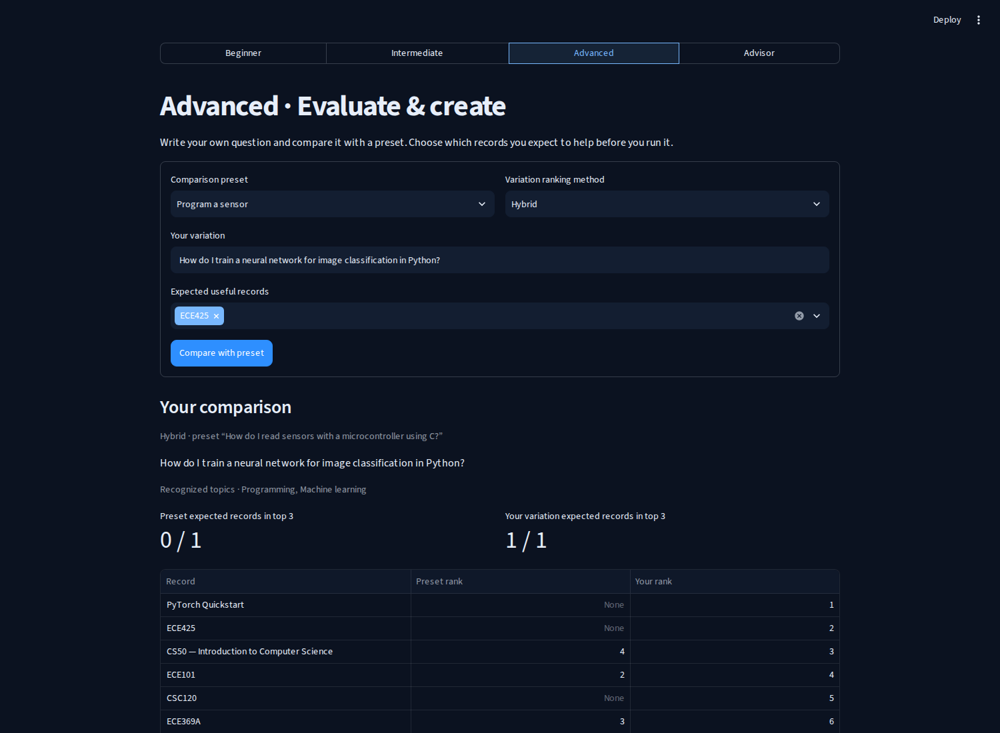
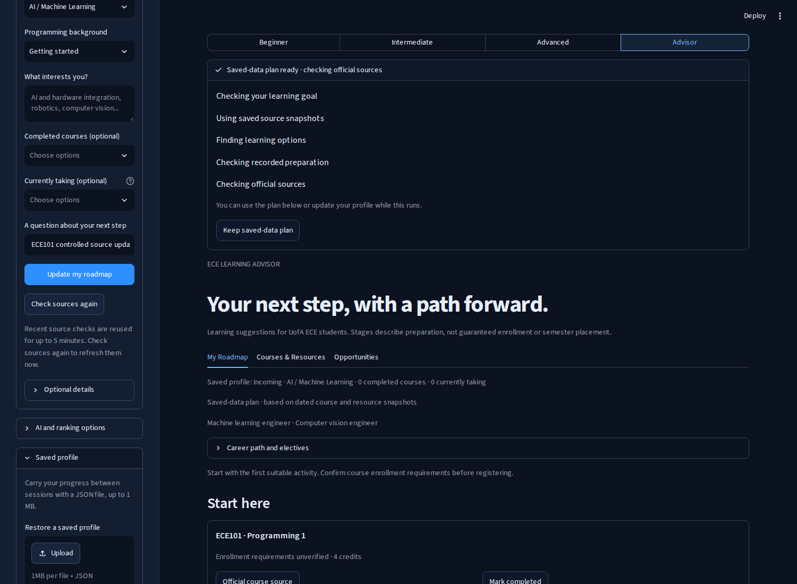
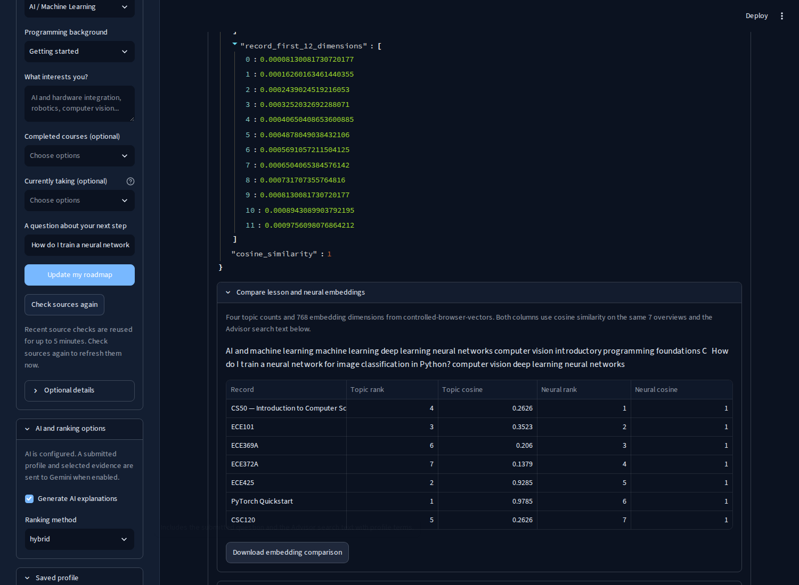
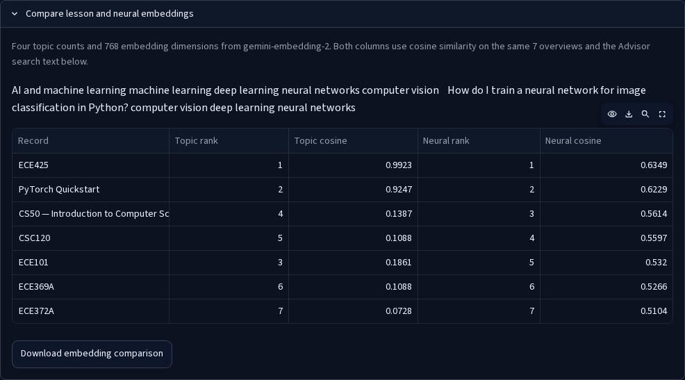

# Application figures

Team P07 · November 15 and November 19, 2026

The first five captures show application revision `034baef173dd783697da72542ce3aa28bdfcf2c7` in Chromium at 1,500 × 1,100. Figure 6 shows the live Gemini rehearsal on the November 19 submission candidate. [Earlier browser run](https://github.com/JSM-Shinkiro/ece-learning-advisor/actions/runs/43688855340) · [Earlier image provenance and hashes](../evidence/report_figures_2026-11-15.json)

## Figure 1. Beginner landing and learning roadmap

The landing introduces embedded systems and AI examples. The learning roadmap leads from interpreting a source to comparing ranks and evaluating a new question.

## Figure 2. Topic cosine in the Intermediate lesson

The plotted positions use a two-dimensional projection of four topic counts. For the sensor question, the cosine ranking places ECE372A ahead of ECE369A.

## Figure 3. Advanced comparison for image classification

In the local Hybrid lesson, ECE425 is absent from the preset ranking and ranks second for the image-classification question. The top three include the one expected record selected for this example.

## Figure 4. Saved-data roadmap during a source check

The controlled source delay keeps the progress panel visible while the learner can use the dated roadmap. ECE101 shows that the enrollment requirements are unverified.

## Figure 5. Advisor comparison with controlled vectors

The browser test supplies controlled vectors for the seven shared overviews. The table shows the comparison layout and download action. [November 15 live CLI rehearsal](../evidence/live_demo_rehearsal_2026-11-15.json)

## Figure 6. Advisor comparison with live Gemini

Chromium captured the inspector after a live Hybrid request for the image-classification question. Both columns rank ECE425 first and PyTorch Quickstart second. ECE101 moves from third with topic counts to fifth with 768-dimensional Gemini embeddings. The browser exported the same seven rows and the request trace. [Rehearsal evidence and hashes](../evidence/gemini_submission_rehearsal_2026-11-19.json)
