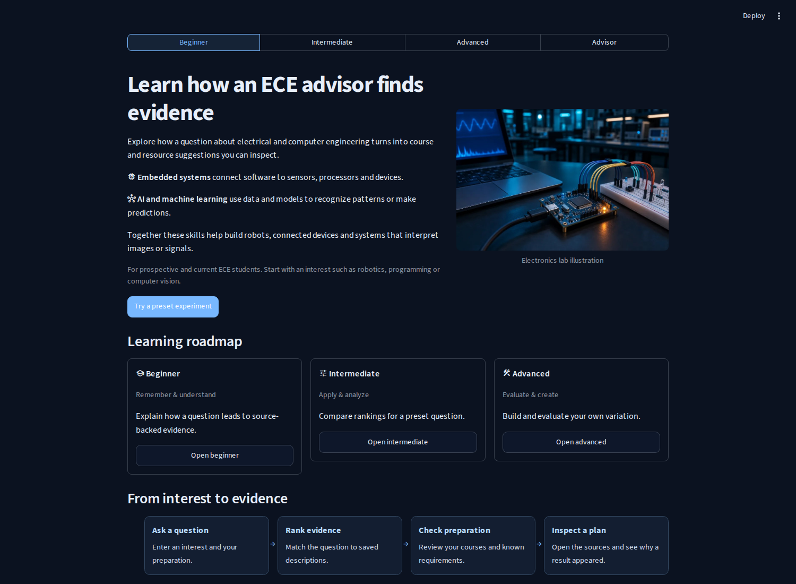
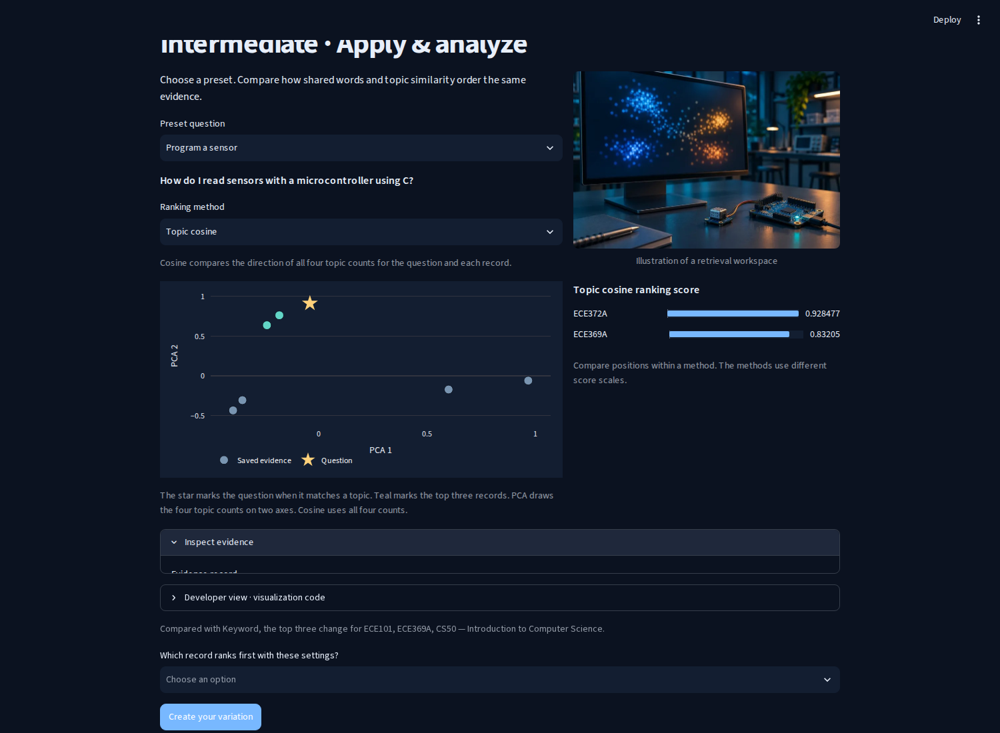

# Application figures

Team P07 · November 15, 2026

The captures show application revision `034baef173dd783697da72542ce3aa28bdfcf2c7` in Chromium at 1,500 × 1,100. The report draft refers to these figures by number. [Passing browser run](https://github.com/JSM-Shinkiro/ece-learning-advisor/actions/runs/43688855340) · [Image provenance and hashes](../evidence/report_figures_2026-11-15.json)

## Figure 1. Beginner landing and learning roadmap

The landing introduces embedded systems and AI examples. The learning roadmap leads from interpreting a source to comparing ranks and evaluating a new question.

## Figure 2. Topic cosine in the Intermediate lesson

The plotted positions use a two-dimensional projection of four topic counts. For the sensor question, the cosine ranking places ECE372A ahead of ECE369A.

## Figure 3. Advanced comparison for image classification

In the local Hybrid lesson, ECE425 is absent from the preset ranking and ranks second for the image-classification question. The top three include the one expected record selected for this example.

## Figure 4. Saved-data roadmap during a source check

The controlled source delay keeps the progress panel visible while the learner can use the dated roadmap. ECE101 shows that the enrollment requirements are unverified.

## Figure 5. Advisor comparison with controlled vectors

The browser test supplies controlled vectors for the seven shared overviews. The table shows the comparison layout and download action. The live CLI rehearsal produced the seven-row Gemini comparison. The browser capture for the final recording remains open. [Live comparison](../evidence/live_demo_rehearsal_2026-11-15.json) · [Demo runbook](DEMO_RUNBOOK.md#one-request-rehearsal)
