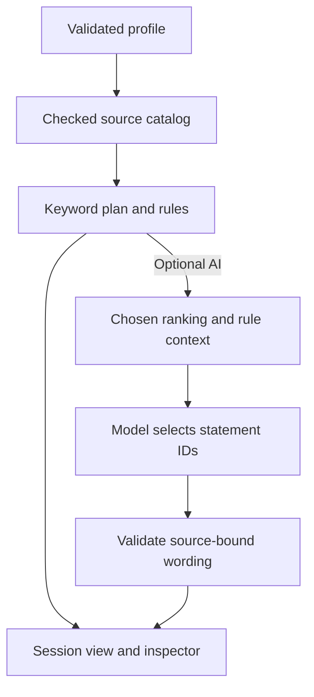

# ECE Learning Advisor: An Inspectable RAG System

Team P07 · ECE 425/525 · Final report draft · November 12, 2026

This draft describes the application through verified revision `07cf4b59693b16dbe6835d6639123261e637860f`. Final formatting, final-release figures and measurements, independent judgments and student-pilot outcomes remain to be incorporated. [Evidence map](EVIDENCE_MAP.md) · [Manifest](EVIDENCE_MANIFEST.json)

## Abstract

ECE Learning Advisor connects a student's interests and recorded coursework with courses, learning resources and public opportunities. The prototype combines keyword or neural retrieval with deterministic preparation checks and source-bound explanation selection. Students can inspect evidence, rankings, full-dimensional cosine calculations and a two-dimensional vector projection. The implementation uses versioned JSON, public-source caches and a small NumPy index; optional pretrained Gemini models supply embeddings and statement selections. The default runtime collection contains 20 courses, eight resources and 34 evidence chunks. A separate published inventory exposes all 78 undergraduate ECE courses in the saved 2026–2027 list, with bounded on-request description access and explicit unreviewed preparation status. Software checks and an authored small-corpus benchmark establish implementation behavior, while a paired offline browser experiment reduces median inspector first opening from 1.608 to 0.687 seconds. Independent relevance judgments, usability outcomes and real-AI latency cohorts have not yet been collected. These distinctions limit the conclusions to demonstrated integration, bounded contracts and measured preview responsiveness.

## 1. Problem and project goals

An incoming ECE student may know an interest such as robotics without knowing an appropriate starting course or resource. A current student needs suggestions that account for completed and ongoing work. Catalog descriptions, program requirements, resource editions and employer listings provide different kinds of evidence; a fluent explanation can obscure those differences.

The application answers a bounded question: given a student's recorded background and an AI/machine-learning or embedded-systems direction, what are reasonable preparation activities and what sources support them? Its stages—**Start here**, **Build toward**, and **Later goals**—describe preparation, not semester placement or complete enrollment approval. An exploring mode helps select a direction. Explicit undergraduate ECE catalog questions can also expose descriptions outside those two mappings, with preparation and enrollment status unreviewed. Graduate advising and a complete degree audit are outside the verified core.

The project preparation notes define four inspection goals. They guide this draft; they are not a claim that a final-specific rubric has been satisfied.

| Goal | Implemented behavior |
| --- | --- |
| G1: latent-space view | PCA of actual document vectors, with the query transformed using the same fitted axes |
| G2: similarity drill-down | Selected vector components, dot product, norms and full-dimensional cosine |
| G3: meaningful controls | Profile/coursework changes, retrieval-method choice, source checks and explicit progress updates |
| G4: measured response | Request-phase timing, early source plans, browser measurements and failure retention |

## 2. Architecture and evidence lifecycle

The student interface is a Streamlit application with a submitted profile form and roadmap, collection and opportunities panels. Python/Pydantic validate records and profiles. NumPy implements vector ranking and PCA; native HTML renders ranking bars, while Plotly renders vector inspection. The default configured neural models are `gemini-embedding-2` and `gemini-3.5-flash-lite`, with 768 embedding dimensions. These are configuration defaults and previously observed integrations, not a guarantee of future provider availability. The project integrates pretrained models; it does not train a new language model. [E2, E5](EVIDENCE_MAP.md)

For background AI requests, the interface can publish the keyword source plan before optional AI completes. The final ranking/context may differ after neural retrieval. A failed optional phase retains usable source information.

The reviewed collection is stored as versioned JSON. Submitted roadmaps can check selected configured official catalog/program/resource pages, validate identity and edition, and overlay supported fields. The source policy bounds a request to eight course, two program and two resource checks; up to three new course descriptions fit within the course budget. Current-source checks remain bounded to selected records. A separate local directory contains the official published undergraduate ECE inventory: 78 courses from two complete list pages, with minimum/maximum credits retained. All entries support completed/current-course selection. Local search and 15-entry pagination do no HTTP or model work; at most three explicit catalog requests enter an advisor overlay. Unmapped entries use an exploration phase, without inferred prerequisites, career fit or course sequencing. The directory does not expand the archived 34-chunk evaluation input. Graduate ECE and complete supporting-subject coverage remain outside this inventory. [E11](EVIDENCE_MAP.md) Successfully checked public sources may be reused for five minutes; their original timestamps are retained. Explicit rechecking bypasses this recent reuse. Failed checks and omitted records retain labeled saved evidence. [E8](EVIDENCE_MAP.md)

Public document embeddings use compressed NumPy cache files with corpus/model/chunk alignment metadata. Ranking is in memory; there is no separate vector-database server. Profiles, plans and active searches live in session memory. Explicit JSON download/upload supports portability, with no account-backed history database. Personal query vectors and generated responses are not placed in the shared public-document embedding cache. [E1, E10](EVIDENCE_MAP.md)

## 3. Retrieval, academic checks and explanations

### 3.1 Keyword, semantic and hybrid retrieval

Retrieval-conditioned generation follows the general RAG motivation of using retrieved evidence alongside a pretrained model [1]. This implementation supplies bounded course/resource evidence and application-owned statements to a selection workflow.

Keyword retrieval implements a BM25 variant [2]. Tokens are normalized, common stop words removed and spaced course codes joined. For unique query terms $t$, the implemented score is

$$
S(q,d)=\sum_{t\in\operatorname{unique}(q)}
\log\!\left(1+\frac{N-n_t+0.5}{n_t+0.5}\right)
\frac{f_{t,d}(k_1+1)}{f_{t,d}+k_1(1-b+b|d|/\overline L)},
\qquad k_1=1.5,\ b=0.75.
$$

Here $N$ is the chunk count, $n_t$ the number containing term $t$, $f_{t,d}$ its frequency, and $\overline L$ the mean tokenized chunk length. Bounded reviewed aliases can add domain vocabulary; they do not change academic conditions.

Semantic retrieval L2-normalizes document/query vectors and computes

$$
\operatorname{cosine}(q,d)=\frac{q\cdot d}{\|q\|\|d\|}.
$$

Zero, nonfinite and dimension-mismatched vectors are rejected. Hybrid retrieval uses reciprocal rank fusion [3]:

$$
\operatorname{RRF}(d)=\sum_{r:\,d\in r}\frac{1}{60+\operatorname{rank}_r(d)}.
$$

Ranks start at one; stable chunk IDs break score ties. Fusion combines positions rather than directly adding BM25 and cosine magnitudes. Context construction then applies directed record preferences, coursework exclusions and preparation rules. The displayed roadmap is therefore not a pure similarity top-k list. [E2](EVIDENCE_MAP.md)

### 3.2 Conservative preparation checks

Prerequisite interpretation runs in Python with satisfied, unsatisfied and unknown states. Missing grades, incomplete histories, edition mismatches and unreviewed conditions can remain unknown. Current enrollment counts only where a reviewed concurrent condition explicitly permits it. Completed/current courses are removed from next-step recommendations without inventing grades.

The runtime collection has four bound CS interpretations: CSC110, CSC120, CSC144 and CSC210. Fifteen ECE conditions and CSC372 remain unknown. These checks cover particular recorded conditions and do not establish complete enrollment eligibility. Descriptive evidence and a strong relevance score cannot substitute for a reviewed academic rule. [E8](EVIDENCE_MAP.md)

### 3.3 Bounded explanation selection

The model selects statement IDs from a source-bound registry. The application supplies wording, labels and citations, then validates membership, ownership, context and exact rendering. The provider cannot add arbitrary explanation prose by calling a fact a suggestion. This reduces free-form personalization and makes the accepted output contract inspectable.

The contract does not establish that an underlying source, parser or authored learning suggestion is correct, or that the chosen statement best answers a question. Those remain evaluation questions. Unsupported requests, failed providers and invalid selections preserve explicit clarification/source-only states. [E2, E4](EVIDENCE_MAP.md)

## 4. Inspection and interaction design

The midproject review prompted a visual introduction and three self-guided lessons. Beginner connects the two ECE directions to practical applications and asks learners to identify the evidence needed to check course preparation. Intermediate presents a preset and lets learners change the ranking method while inspecting the evidence and the projected vectors. Advanced compares a learner's question with a preset under the same method and records an explanation of a rank change. These activities address remembering and understanding, applying and analyzing, and evaluating and creating. [E13](EVIDENCE_MAP.md)

The lesson represents seven saved course and resource overviews as counts of listed terms in four topic dimensions. This representation lets learners inspect the features used by cosine ranking and PCA. They can also compare BM25 and reciprocal rank fusion. The Advanced exercise reports the number of learner-selected records in the first three results, along with their rank changes and the learner's observation. The advisor offers the separately configured Gemini embedding and explanation path. Both visualization views expose their actual source code. [E13](EVIDENCE_MAP.md)

The inspector exposes retrieved chunks, component scores, the supplied context, available/selected statements, source checks, model/cache metadata, request timings and a downloadable trace. Scores describe relevance, not eligibility or probability.

For PCA, normalized document rows are centered and decomposed by SVD. The first two right-singular-vector directions project both documents and the separately normalized query using the document mean. Ranking continues in the original dimensions. Changing the inspected record recomputes its displayed dot product, norms and cosine from the stored vectors. Two-dimensional proximity is only a visualization of that higher-dimensional input.

The closed inspector omits its contents. Opening/closing reruns its fragment. A simple ranking chart uses escaped HTML/CSS bars with a shared zero baseline and signed-score support, retaining the exact score table. The vector view still uses Plotly. Collection filtering, lazy source details and opportunity interactions also operate independently of roadmap generation. Browser checks cover a 390-pixel viewport; they do not establish mobile-device performance. [E6, E7](EVIDENCE_MAP.md)

AI requests use session-owned background jobs with four in-process worker slots. New profiles supersede old requests; late results cannot replace a newer profile's plan. A shared default 45-second cooperative AI budget begins after source checks. Keeping the source plan stops acceptance of later AI output. Already running I/O can outlast cancellation, so this is not a hard whole-request deadline. [E9](EVIDENCE_MAP.md)

Opportunities use explicit public Greenhouse-board searches for Samsara, Nuro and Anduril, with title/location filters, paging and listing-bound detail checks. Source metadata and empty/failure states remain visible. This is a search over configured boards, not a comprehensive market or qualification assessment. Optional Adzuna/OpenRouter work is outside the verified core. [E10](EVIDENCE_MAP.md)

## 5. Evaluation method and observed results

### 5.1 Collections and retrieval experiment

| Input | Courses | Resources | Career mappings | Evidence chunks |
| --- | ---: | ---: | ---: | ---: |
| Frozen development baseline | 5 | 2 | 2 | 10 |
| Saved runtime collection | 20 | 8 | 2 | 34 |

The historical retrieval experiment uses sixteen assistant-authored queries and complete graded references on the ten-chunk baseline. Relevance is grade 2 or 3 on a 0–3 scale. Precision@5 uses a fixed denominator of five, including shorter result lists; recall divides retrieved relevant chunks by all judged relevant chunks. MRR uses the first relevant rank within the cutoff. nDCG uses linear grade gain divided by $\log_2(\mathrm{rank}+1)$. Results are query-macro averages, excluding undefined metrics. [E3, E4](EVIDENCE_MAP.md)

| Method | Query treatment | Queries | P@5 | R@5 | MRR@5 | nDCG@5 |
| --- | --- | ---: | ---: | ---: | ---: | ---: |
| Keyword | Raw | 16 | 0.3125 | 0.8229 | 0.8229 | 0.7571 |
| Keyword | Domain aliases | 16 | 0.3750 | 0.9479 | 0.9583 | 0.8988 |
| Semantic | Domain aliases | 16 | 0.4000 | 1.0000 | 0.9688 | 0.9523 |
| Hybrid | Domain aliases | 16 | 0.4000 | 1.0000 | 0.9688 | 0.9518 |

The expanded-query experiment adds aliases without production profile expansion. Aliases were authored after known misses; these are development comparisons, including the files' original development/validation tags, not independent held-out results. The mean fixed-k precision ceiling is 0.4000 because the labeled relevant sets are small. Recall 1.0000 here does not mean answer accuracy or quality on the runtime collection. The neural benchmark used `gemini-embedding-2` at 768 dimensions. Its document-index cache was a hit: zero document calls and sixteen query calls were recorded, with zero generation/source-refresh calls in that experiment.

The bounded statement contract accepts 82/82 authored canonical controls and admits zero unsupported reviewed claims in its offline probes. Controls recur across contexts; they are not 82 independent facts. The contract rejects unlisted true paraphrases as well. These observations validate a restricted rendering format, not a hallucination rate or unrestricted factual inference. [E4](EVIDENCE_MAP.md)

### 5.2 Provider and software integration

Expanded-catalog observations record a finite 34 × 768 public-document index and authored request scenarios. An initial query-embedding ProxyError stopped part of the suite; one explicit bounded follow-up exercised the failed/unrun scenarios. Both outcomes remain in the record. This supports integration observations, not an estimated reliability rate or independent selection quality. [E5](EVIDENCE_MAP.md)

At the November 8 directory revision, all 1,744 tests and nine runtime checks pass on both Linux and Windows. Twenty-nine Chromium gates cover student workflow/session isolation, the reviewer workspace, controlled AI/browsing and phone-width inspection. The browser job also passes five timing sessions per version. Linux jobs explicitly select Ubuntu 26.04; dependency/action versions and raw reports are retained. Fixture-based checks remain identified as controlled tests. These counts measure software expectations, not independent recommendation accuracy. [E7](EVIDENCE_MAP.md)

The November 12 follow-up passed 1,745 tests and nine runtime checks on each platform. Chromium passed 32 gates, including the phone-width landing, a change of ranking method with code inspection, and the export of an Advanced comparison. The offline example moved ECE425 from sixth to second under hybrid ranking. The learner's selected record count in the top three rose from 0 of 1 to 1 of 1. The demonstration evaluates the specified example, and participant understanding remains to be measured. [E13](EVIDENCE_MAP.md)

### 5.3 Preview responsiveness experiment

The inspector comparison uses one Linux x86-64/four-logical-CPU CI runner, Python 3.12.16, Chromium 151.0.7922.34 and a 1,500 × 1,100 viewport. Each version has its own production server/browser process and five fresh contexts, sharing processes within that cohort. Current app runs precede the fixed baseline. AI and source downloads are disabled; browser HTTP caching is disabled by request routing. The v2 readiness boundary requires a laid-out ranking visualization and an enabled trace-download control. Reopening follows content removal and completion of the close animation. [E6](EVIDENCE_MAP.md)

| Boundary | Version | n | Minimum (ms) | Median (ms) | Maximum (ms) |
| --- | --- | ---: | ---: | ---: | ---: |
| First inspector opening | Plotly baseline | 5 | 1,583.8 | 1,608.4 | 1,833.0 |
| First inspector opening | Native ranking | 5 | 663.7 | 686.7 | 762.2 |
| Inspector reopening | Plotly baseline | 5 | 342.9 | 361.8 | 368.7 |
| Inspector reopening | Native ranking | 5 | 295.5 | 307.8 | 319.0 |

The first-opening median decreases by 57.3% within this experiment. Native bars avoid initializing Plotly for the simple preview ranking view; the exact contribution of transfer, initialization and server work is not separately isolated. The November 8 CI repeat records native/baseline first-opening medians of 683.7/1,714.0 ms in a separate five-session comparison. That repeat is retained separately, not pooled with the optimization sample. [E7](EVIDENCE_MAP.md)

These are animation-frame DOM observations, including offscreen laid-out controls, not physical paint or field interaction metrics. Shared-runner variability, ordered small samples and shared processes limit inference. No p95, significance test, live-AI latency distribution or student-device performance is established. Server phase timings use a separate clock and exclude provider cleanup/browser rendering.

The November 8 readiness audit adds individual source-only observations: 21.664 seconds with an empty audit cache and recovered network timeouts, 13.191 seconds using a disk cache in a new process, and 0.066 seconds for immediate same-process reuse with zero HTTP attempts. A separate employer search/detail observation takes 19.799 seconds and verifies all three boards plus the selected posting. No model calls are used. These are workspace/network-specific server observations, not repeated cohorts, browser response times or live-AI latency. They identify fresh network waiting as an unresolved interaction concern despite fast recent reuse. [E12](EVIDENCE_MAP.md)

## 6. Limitations and next validation

The 34-chunk runtime review bundle has twelve development questions and 408 blank grades. No independent runtime relevance score or student-pilot outcome is available at this draft date. The [pilot protocol](STUDENT_PILOT.md) and separate reviewer workspace prepare collection; they do not supply participant observations or authenticate reviewer independence. A held-out claim requires separately archived questions/judgments fixed before tuning.

Published undergraduate ECE description coverage is broader than advising coverage: career mappings still focus on two directions, ECE prerequisite interpretations remain unreviewed, and complete supporting-course/degree auditing remains open. Opportunity coverage uses three employer boards. Source parsing, edition identity, authored statement quality and statement-selection relevance can still fail. Accounts/history persistence, distributed-worker coordination and a validated public-host deployment remain outside the verified implementation. Reproducible local access is available; final access requirements must be reconciled with the final instructions.

Before release, collect genuine judgments and student observations, measure real-AI/source/cache behavior on a frozen revision, capture final application figures, and finish the required report format, slides and new recording. Current results support an inspectable, failure-aware implementation and an offline preview rendering improvement. General advising effectiveness remains unevaluated.

## References

1. P. Lewis et al. (2020). [Retrieval-Augmented Generation for Knowledge-Intensive NLP Tasks](https://arxiv.org/abs/2005.11401).
2. S. Robertson and H. Zaragoza (2009). [The Probabilistic Relevance Framework: BM25 and Beyond](https://doi.org/10.1561/1500000019).
3. G. V. Cormack, C. L. A. Clarke and S. Büttcher (2009). [Reciprocal Rank Fusion outperforms Condorcet and individual Rank Learning Methods](https://cormack.uwaterloo.ca/cormacksigir09-rrf.pdf).
4. University of Arkansas Teaching Innovation and Pedagogical Support. [Using Bloom’s Taxonomy](https://tips.uark.edu/using-blooms-taxonomy/).

Implementation and experimental sources are indexed in [E1–E13](EVIDENCE_MAP.md); exact file identities are in [the manifest](EVIDENCE_MANIFEST.json).
